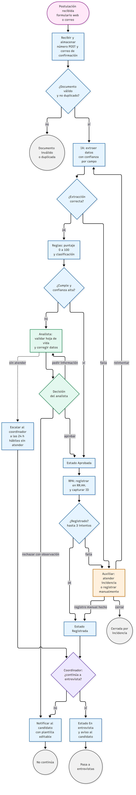
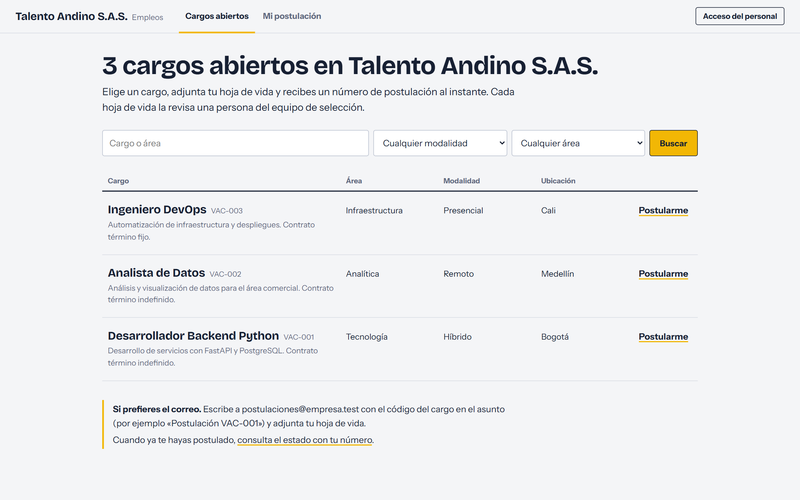
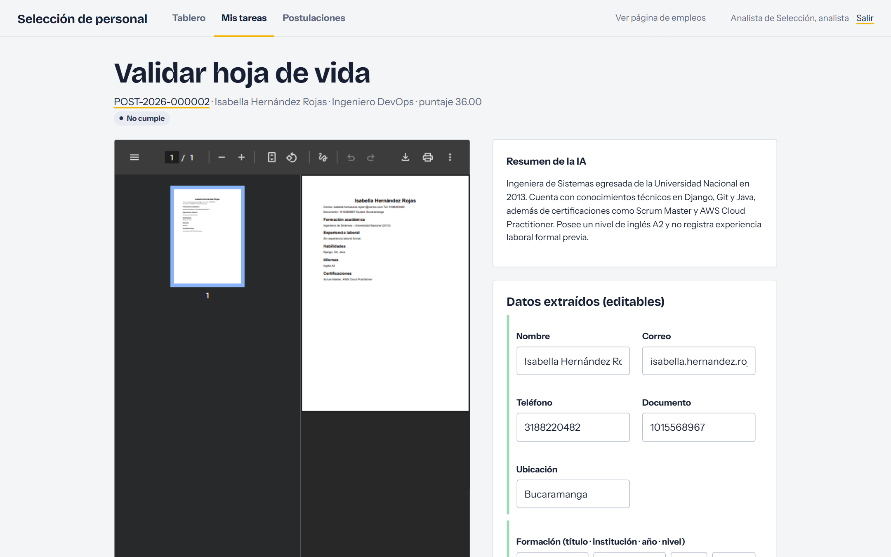
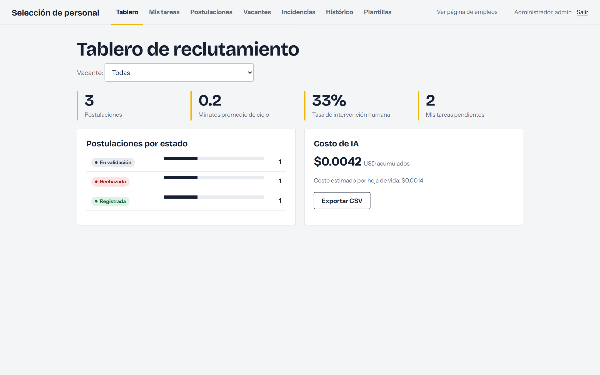
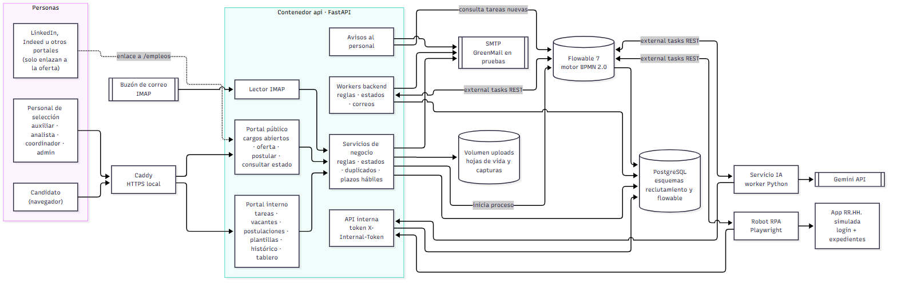

# Reclutamiento automatizado con Flowable, IA y RPA

Proyecto final del curso **Automatización de procesos**. Es un prototipo funcional del proceso de reclutamiento rediseñado (TO-BE):
un candidato se postula, su hoja de vida llega leída por IA, puntuada con reglas y registrada en el sistema de Recursos Humanos por
un robot, sin que nadie digite datos. Las personas intervienen solo donde hace falta criterio: validar, rechazar con observación y
decidir quién pasa a entrevista.

**Equipo:** Felipe · Andrés · Juan José · Federico · Valentina

**Video de la presentación:** [ver video](ENLACE_AL_VIDEO)

| | |
|---|---|
| **Orquestación** | Flowable 7 (BPMN 2.0) con *external workers* |
| **Inteligencia artificial** | Google Gemini: extracción estructurada de la hoja de vida, con OCR para documentos escaneados |
| **RPA** | Playwright: robot que inicia sesión en el sistema de RR. HH. y registra al candidato |
| **Aplicación** | FastAPI + Jinja2 (página pública de empleos y portal interno), PostgreSQL |
| **Infraestructura** | Docker Compose: 8 contenedores que se levantan con un solo comando |

---

## Contenido

1. [El problema](#1-el-problema)
2. [Modelado del proceso y caso de negocio](#2-modelado-del-proceso-y-caso-de-negocio)
3. [La solución](#3-la-solución)
4. [Arquitectura](#4-arquitectura)
5. [Cómo ejecutarlo](#5-cómo-ejecutarlo)
6. [Recorrido sugerido](#6-recorrido-sugerido)
7. [Pruebas y resultados medidos](#7-pruebas-y-resultados-medidos)
8. [Estructura del repositorio](#8-estructura-del-repositorio)
9. [Decisiones, alcance y limitaciones](#9-decisiones-alcance-y-limitaciones)

---

## 1. El problema

En el proceso actual (AS-IS), el equipo de selección hace a mano cinco tareas repetitivas por cada postulación:

| Tarea manual | Veces al mes | Tiempo por vez |
|---|---|---|
| Revisar correos y formularios | 200 | 2 min |
| Descargar y organizar la hoja de vida | 200 | 2 min |
| Leer la hoja de vida y extraer sus datos | 180 | 6 min |
| Registrar al candidato en el sistema de RR. HH. | 90 | 3 min |
| Actualizar el estado y organizar el expediente | 90 | 4 min |

En la simulación de 50 solicitudes, el proceso manual cuesta **455.200** y tarda en promedio **27,9 minutos por solicitud** dentro
del horario laboral. El analista y el auxiliar dedican el 35 % y el 32 % de su tiempo a trabajo repetitivo.

## 2. Modelado del proceso y caso de negocio

El proceso se modeló en BPMN en sus versiones actual y propuesta, y ambas se simularon en BIMP con 50 solicitudes.
Todos los archivos están en [`docs/modelado_procesos/`](docs/modelado_procesos/):

- `AS-IS/Reclutamiento_AS_IS.bpmn` y `TO-BE/Reclutamiento_TO_BE_Limpio.bpmn`: los modelos.
- `*/simulation_results.csv`, `RESULTADOS.jpeg` y mapas de calor de tiempo y costo: los resultados de la simulación.
- `Caso_de_Negocio.xlsx`: inversión, flujo de caja e indicadores financieros.

**Resultados de la simulación (50 solicitudes)**

| Indicador | AS-IS (manual) | TO-BE (automatizado) | Cambio |
|---|---|---|---|
| Costo total | 455.200 | 191.200 | **−58 %** |
| Ciclo promedio por solicitud, con esperas | 81,9 min | 26,0 min | **−68 %** |
| Ciclo dentro del horario | 27,9 min | 7,2 min | **−74 %** |

**Caso de negocio:** inversión única de 6.740.000 (desarrollo, integración, pruebas y capacitación) y 200.000 al mes de
infraestructura, API de IA y soporte. Con una tasa de descuento del 12 %, la inversión se recupera en el **mes 12**, con un
valor presente neto a 3 años de **12.886.776**, una TIR del **172 %**, un retorno de la inversión del **258 %** y **849.332** de tiempo liberado cada mes.

## 3. La solución

El flujo implementado sigue el modelo TO-BE:



1. **Recepción.** El candidato entra a la página pública de empleos, elige un cargo y se postula sin crear cuenta: datos de
   contacto, hoja de vida en PDF o Word (máximo 5 MB) y autorización de tratamiento de datos (Habeas Data). También puede enviar
   su hoja de vida por correo con el código de la vacante en el asunto. El sistema valida el archivo, detecta duplicados (mismo
   correo o mismo archivo en 30 días), asigna un número `POST-AAAA-nnnnnn` y envía un correo de confirmación.
2. **Extracción con IA.** Gemini convierte la hoja de vida en datos estructurados (datos personales, formación, experiencia,
   habilidades, idiomas), marca la confianza de cada campo y escribe un resumen. La salida se valida contra un esquema y se
   reintenta si viene incompleta. Los años de experiencia se calculan en código, no con el modelo.
3. **Reglas.** El sistema compara el perfil con los requisitos de la vacante y calcula un puntaje de 0 a 100 con pesos
   configurables. Con ese puntaje clasifica la hoja de vida como `Cumple`, `Revisar` o `No cumple`.
4. **Validación humana.** Si la hoja no es `Cumple` o la IA tuvo poca confianza, el analista ve el PDF junto a los datos
   editables, con los campos dudosos resaltados. Puede aprobar, rechazar o pedir información. **Todo rechazo exige una observación.**
5. **Registro por RPA.** El robot inicia sesión en el sistema de RR. HH., busca al candidato para no duplicarlo, lo registra con
   su archivo y devuelve el ID asignado. Si falla tres veces, la postulación queda en `Error` con una incidencia, una captura de
   pantalla y una tarea de registro manual para el auxiliar.
6. **Decisión del coordinador.** El coordinador decide si el candidato continúa. Si continúa, recibe un aviso por correo y el
   proceso termina en «En entrevista». Si una validación lleva 24 horas hábiles sin atenderse, se escala al coordinador.

Dos principios guían el diseño: **la IA sugiere, las reglas puntúan y las personas deciden**, y **ninguna postulación se
pierde**: toda falla deja estado, incidencia y tarea manual.

Además del flujo, el portal interno incluye la gestión de vacantes (requisitos y pesos sin tocar código), un tablero con
postulaciones por estado, tiempo de ciclo, tasa de intervención humana y costo de IA, la trazabilidad completa de cada
postulación, plantillas de correo editables, histórico de vacantes cerradas y exportación a CSV.

| Página pública de empleos | Validación con la hoja de vida al lado | Tablero |
|---|---|---|
|  |  |  |

## 4. Arquitectura



| Contenedor | Función |
|---|---|
| `postgres` | Base de datos del reclutamiento y de Flowable |
| `flowable` | Motor BPMN: ejecuta el proceso, crea las tareas humanas y el temporizador de escalación |
| `api` | FastAPI: página pública, portal interno, reglas, estados, correos, lector IMAP y API interna |
| `ia` | Worker de IA: toma las tareas `extraer-cv` y llama a Gemini |
| `rpa` | Worker del robot (Playwright): toma las tareas `registrar-rpa` |
| `rrhh` | Sistema de RR. HH. simulado, donde escribe el robot |
| `greenmail` | Servidor de correo de pruebas (SMTP e IMAP) |
| `https` | Caddy: acceso por HTTPS |

Flowable no llama a los servicios: publica el trabajo por tópicos y cada worker lo toma por REST (*external workers*). Así, la IA
y el robot se despliegan y escalan por separado, y si un worker se cae, el bloqueo expira y otro retoma la tarea.
Más detalle en [`docs/arquitectura.md`](docs/arquitectura.md) y el modelo de datos en [`docs/clases.md`](docs/clases.md).

## 5. Cómo ejecutarlo

**Requisitos:** Docker Desktop y una clave gratuita de Gemini (<https://aistudio.google.com/apikey>).

```bash
cp .env.example .env          # escribe tu GEMINI_API_KEY y cambia las contraseñas
docker compose up -d --build  # la primera vez tarda unos 5 minutos
```

Cuando <http://localhost:8000/health> responda `{"postgres":"ok","flowable":"ok"}`, el sistema está listo (Flowable tarda
alrededor de un minuto en arrancar).

| Qué | Dirección | Acceso |
|---|---|---|
| Página de empleos y portal interno | <http://localhost:8000> | usuarios abajo |
| El mismo portal por HTTPS (acepta la advertencia del certificado local) | <https://localhost:8443> | — |
| Documentación de la API (Swagger) | <http://localhost:8000/docs> | — |
| Sistema de RR. HH. simulado | <http://localhost:9000> | `robot` / `robot123` |
| API REST de Flowable | <http://localhost:8081/flowable-rest/service> | `rest-admin` / `test` |

**Usuarios del portal interno** (contraseña `demo1234`): `auxiliar@empresa.test`, `analista@empresa.test`,
`coordinador@empresa.test` y `admin@empresa.test`.

Para empezar de cero: `docker compose down -v` y luego `docker compose up -d --build`.

> **Cuota de Gemini:** el plan gratuito permite unas 20 peticiones por día y modelo. El sistema usa una cadena de modelos de
> respaldo (`GEMINI_MODELS` en `.env`) y pasa al siguiente cuando uno se agota.

## 6. Recorrido sugerido

1. Abre <http://localhost:8000>, entra a **VAC-002 Analista de Datos** y postúlate con un archivo de `datos_prueba/`
   (por ejemplo `cv_181_simple.pdf`, que cumple los requisitos). Recibirás un número de postulación.
2. Espera entre 10 y 45 segundos y abre <http://localhost:9000/candidatos>: el robot ya registró al candidato con su ID `RH-…`.
3. Entra como `analista@empresa.test` → *Postulaciones* → abre la postulación y revisa la trazabilidad (IA, reglas, robot).
4. Postúlate con `cv_153_simple.pdf` (clasificación `Revisar`) y valídala en *Mis tareas*. Intenta rechazar sin observación: el sistema no lo permite.
5. Para ver la recuperación ante fallas, abre <http://localhost:9000/admin>, pulsa **Provocar fallas** y postula otra hoja que
   cumpla: quedará en `Error`, con incidencia, captura y tarea manual para `auxiliar@empresa.test`.
6. Entra como `coordinador@empresa.test` para decidir la continuidad, y como `admin@empresa.test` para ver el tablero y las plantillas.

El guion completo de la demostración está en [`docs/guion_demo.md`](docs/guion_demo.md).

## 7. Pruebas y resultados medidos

```bash
python -m venv .venv && .venv/Scripts/pip install -r requirements-dev.txt   # Linux/Mac: .venv/bin/pip
.venv/Scripts/python -m pytest tests -q              # pruebas unitarias
.venv/Scripts/python scripts/e2e.py todos            # escenarios punta a punta (con docker compose arriba)
.venv/Scripts/python scripts/evaluar_extraccion.py 20   # precisión de la IA contra la verdad terreno
.venv/Scripts/python scripts/carga.py 20 5           # carga: 20 postulaciones, 5 en paralelo
```

`datos_prueba/` contiene 200 hojas de vida sintéticas en cuatro formatos (simple, columnas, escaneada y Word), cada una con su
verdad terreno en JSON. Se generan con `scripts/generar_cvs.py`.

| Métrica | Meta | Resultado |
|---|---|---|
| Precisión de la extracción de la IA | ≥ 90 % | **99,6 %** (239 de 240 campos, 20 hojas de vida de 4 formatos) |
| Tiempo de extracción (p90) | ≤ 30 s | **8,5 s** |
| Ciclo automático (recepción → registro o tarea humana) | ≤ 5 min | **43 s** |
| Capacidad | 50 al día, 5 en paralelo | 20 postulaciones con 5 en paralelo en **173 s** |
| Postulaciones perdidas | 0 | **0** |
| Pruebas | reglas y 3 flujos | **29 pruebas unitarias** y **9 escenarios punta a punta** |

La relación completa entre cada requerimiento, su implementación y su evidencia está en [`docs/trazabilidad.md`](docs/trazabilidad.md).

## 8. Estructura del repositorio

```
docker-compose.yml          los 8 servicios
.env.example                configuración (copiar a .env)
db/                         esquema de PostgreSQL
caddy/                      configuración de HTTPS
services/
  api/                      FastAPI: portal, reglas, estados, correos, IMAP, API interna
    app/bpmn/               proceso BPMN que ejecuta Flowable
    app/templates/          pantallas (Jinja2)
  ai/                       worker de IA y prompts editables
  rpa/                      worker del robot (Playwright)
  rrhh/                     sistema de RR. HH. simulado
  common/                   cliente de external workers, confianza y cálculo de experiencia
scripts/                    generador de hojas de vida, generador del BPMN, pruebas e2e, carga y precisión
tests/                      pruebas unitarias (pytest)
datos_prueba/               hojas de vida sintéticas con verdad terreno
docs/
  modelado_procesos/        BPMN AS-IS y TO-BE, simulación BIMP y caso de negocio
  requerimientos/           requerimientos funcionales y no funcionales, historias de usuario
  diagramas/                flujo, arquitectura y clases (fuente Mermaid + PNG)
  presentacion/             presentación del proyecto (abrir presentacion.html en el navegador)
  arquitectura.md           detalle de la arquitectura
  clases.md                 modelo de datos
  trazabilidad.md           requerimientos → implementación → evidencia
  decisiones_y_cambios.md   decisiones técnicas y diferencias con el modelo y los documentos iniciales
  guion_demo.md             guion de la demostración
  referencias.md, THIRD_PARTY.md   repositorios consultados y licencias
```

## 9. Decisiones, alcance y limitaciones

**Diferencias con el modelo TO-BE**, explicadas en [`docs/decisiones_y_cambios.md`](docs/decisiones_y_cambios.md):
- Una hoja de vida que cumple con alta confianza pasa al registro sin validación del analista. En el modelo, toda hoja válida pasa por el analista.
- «Revisar perfil preseleccionado» se integró en la validación del analista.
- Se agregaron detección de duplicados, reintentos del robot con tarea manual, escalación a 24 horas hábiles, avisos por correo,
  página pública y gestión de vacantes.

**Alcance:** el proceso termina cuando el candidato pasa a entrevistas. La entrevista se hace fuera del sistema.

**Limitaciones conocidas:**
- Los correos salen a un buzón de pruebas local (GreenMail). Para enviarlos de verdad hay que configurar `SMTP_*` e `IMAP_*` en `.env`.
- El plan gratuito de Gemini tiene un tope diario de peticiones.
- La usabilidad no se midió con usuarios reales.
- Las hojas de vida de prueba son sintéticas.
- El HTTPS local usa un certificado interno de Caddy, por lo que el navegador muestra una advertencia.
- El plazo en horas hábiles se calcula al iniciar cada proceso: si cambian el horario o los festivos, las validaciones ya abiertas conservan su plazo.

**Próximos pasos:** conectar un servidor de correo real, medir la usabilidad con analistas, cargar los festivos en el
calendario hábil y probar con hojas de vida reales con consentimiento de sus dueños.
