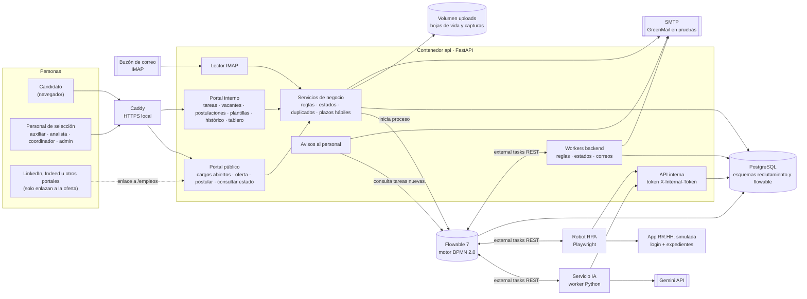
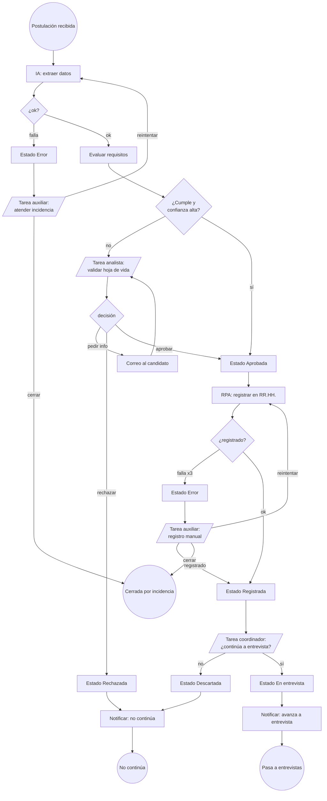
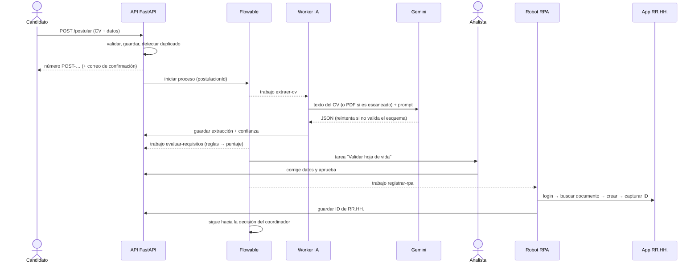

# Arquitectura del sistema

## 1. Vista de componentes

Imagen: `docs/diagramas/arquitectura.png` (fuente `arquitectura.mmd`). El flujo del proceso está en `docs/diagramas/flujo.png`.

**Decisión central: *external workers* de Flowable.** El BPMN no llama a los servicios: publica trabajo en un tópico
(`extraer-cv`, `registrar-rpa`…) y cada worker lo toma por REST (`/external-job-api/acquire/jobs`), lo ejecuta y lo completa
con variables. Beneficios: los servicios se despliegan y escalan por separado (RNF-17), el paralelismo es natural (RNF-04),
no hay acoplamiento síncrono y una caída de un componente no pierde trabajo (el bloqueo del trabajo expira y otro worker lo retoma).

## 2. Proceso orquestado (BPMN TO-BE ejecutable)

El BPMN se genera con `scripts/gen_bpmn.py` y se despliega solo al arrancar la API
(`services/api/app/bpmn/reclutamiento.bpmn20.xml`). Los datos pesados viven en PostgreSQL; el proceso solo lleva
`postulacionId` y las banderas de decisión.

## 3. Secuencia de una postulación (camino feliz con validación humana)

## 4. Despliegue

Un solo `docker compose up -d --build` levanta ocho contenedores:

| Servicio | Imagen / build | Puerto | Responsabilidad |
|---|---|---|---|
| `postgres` | postgres:16 | — | Esquema `reclutamiento` (app) y `flowable` (motor) |
| `flowable` | flowable/flowable-rest:7.1.0 | 8081 | Motor BPMN, tareas humanas, external workers |
| `api` | `services/api` | 8000 | Portal, reglas, notificaciones, IMAP, API interna, despliegue del BPMN |
| `https` | caddy:2 | 8443 | HTTPS local (proxy inverso hacia `api`) |
| `ia` | `services/ai` | — | Worker: `extraer-cv` |
| `rpa` | `services/rpa` (Playwright) | — | Worker: `registrar-rpa` |
| `rrhh` | `services/rrhh` | 9000 | Sistema de RR.HH. simulado (web con login) |
| `greenmail` | greenmail/standalone | 3025 / 3143 | SMTP e IMAP de pruebas |

Los volúmenes `pgdata`, `uploads` (hojas de vida y capturas) y `rrhhdata` conservan los datos entre reinicios; los servicios
tienen `restart: unless-stopped` (RNF-15).

## 5. Decisiones de diseño relevantes

| Tema | Decisión | Por qué |
|---|---|---|
| Orquestación | Flowable con external workers | Desacopla componentes, reintentos y paralelismo nativos |
| IA | Gemini con salida JSON + validación Pydantic + reintentos; cadena de modelos de respaldo | La capa gratuita tiene cuota diaria por modelo (descubierto en pruebas) |
| IA vs. decisión | La IA solo extrae y sugiere; reglas deterministas puntúan; personas deciden | RNF-13, explicabilidad y riesgo legal |
| Experiencia | Se calcula en código fusionando periodos solapados | Los LLM suman mal fechas |
| Robot | Busca antes de crear; idempotente ante reintentos de Flowable | RF-23, evitar duplicados |
| Fallas | Toda falla → estado `Error` + incidencia (+ captura) + tarea humana | RNF-06: ninguna postulación se pierde |
| Seguridad | JWT en cookie httpOnly, roles por tarea, bcrypt, token interno entre servicios, HTTPS (Caddy), secretos en `.env` | RNF-08/09/11 |
| Escalación | Temporizador de frontera no interruptor en la tarea de validación; la duración la calcula `app/horario.py` (horas hábiles) o viene de `ESCALACION_ISO` (modo corridas) | RF-19 |
| Avisos al personal | Hilo que detecta tareas nuevas en Flowable y envía un correo por tarea y grupo (deduplicado en BD) | RF-29, HU-16 |
| Datos personales | Casilla Habeas Data obligatoria, archivos no públicos, borrado por solicitud (admin) | RNF-10/11 |
| Configurabilidad | Requisitos y pesos en BD; prompts en archivos | RNF-18 |
