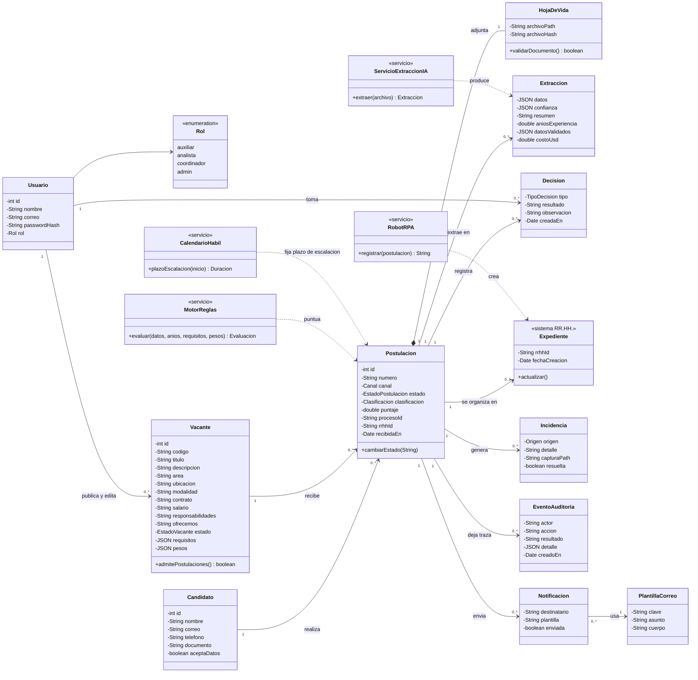

# Diagrama de clases (modelo implementado)

Imagen: `docs/diagramas/clases.png` (fuente `clases.mmd`). Es el modelo que realmente existe en la base de datos (`db/01-schema.sql`) y en el código. Extiende el diagrama de
clases inicial del equipo con las clases que la implementación necesitó (ver la tabla de cambios al final).

## Qué cambió respecto al diagrama inicial

| Cambio | Motivo |
|---|---|
| Nueva `Vacante` (con `requisitos` y `pesos`) | Sin ella no existen RF-13/14/30: los requisitos se configuran por vacante |
| `AnalistaSeleccion` y `CoordinadorSeleccion` → una sola clase `Usuario` con `Rol` | Mismos datos y distinto permiso; añade `auxiliar` y `admin` y alinea HU y RF (que usaban nombres de rol distintos) |
| `Postulacion.documentoValido` y `cumpleRequisitos` (booleanos) → `clasificacion` (Cumple / Revisar / No cumple) + `puntaje` | RF-14 y RF-15 piden puntaje y tres clases, no un booleano |
| `Postulacion.estado` con 10 valores | RF-25 + `Duplicada` (RF-05) |
| `HojaDeVida.datosExtraidos` → clase `Extraccion` aparte | Se conservan varias extracciones (reintentos), la confianza por campo, la versión corregida por la persona y el costo de IA |
| Nuevas `Decision`, `Incidencia`, `EventoAuditoria`, `Notificacion` | HU-13 (trazabilidad), HU-15 (errores), HU-16 (notificaciones), RF-18 (observación obligatoria) |
| `Expediente` se mantiene como el registro en el sistema de RR.HH. | Es lo que crea el robot; se enlaza con `Postulacion.rrhhId` |
| Servicios `MotorReglas`, `ServicioExtraccionIA`, `RobotRPA` | Los métodos `validarDatosYRequisitos`, `validarDocumento` salen de las entidades y pasan a servicios, para que la IA no decida |
| `Vacante` con datos públicos (área, ubicación, modalidad, contrato, salario, responsabilidades, qué ofrecemos) | Página pública de empleos y oferta para LinkedIn u otros portales |
| `Usuario` publica y edita `Vacante` | Pantalla de gestión de vacantes (auxiliar y admin) |
| Nueva `PlantillaCorreo` usada por `Notificacion` | RF-28: textos de correo editables desde pantalla |
| Nuevo servicio `CalendarioHabil` | RF-19: plazo de escalación en horas hábiles |
